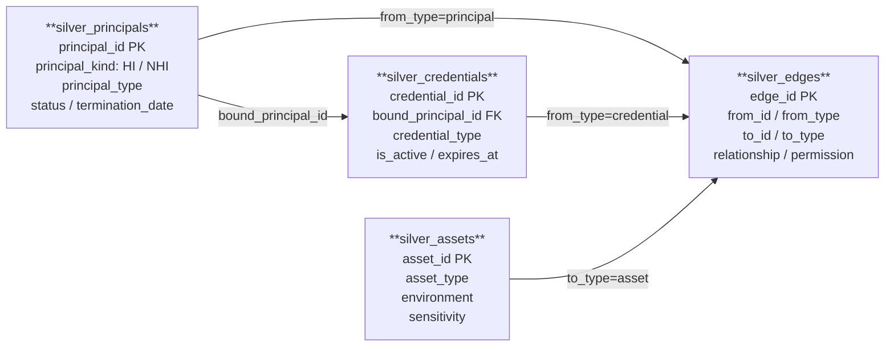

# Silver Schema Contract

## 버전

```text
version: 0.1.0
status: draft
updated_at: 2026-06-24
```

## 변경이력

| 버전 | 날짜 | 변경 내용 |
| --- | --- | --- |
| 0.1.0 | 2026-06-24 | 최소 Silver 4테이블 계약, deterministic id, relationship 매트릭스, 처리 방식 추가 |

## 목적

Silver는 원본 데이터를 공통 모델로 정규화하는 레이어다.

Silver에는 탐지에 필요한 사실만 둔다. 위험 점수, severity, finding, 권장 조치, 화면 표시용 문구는 Silver에 두지 않는다.

## ERD



> `silver_edges`는 폴리모픽 구조다. `from_id`, `to_id`는 `from_type`, `to_type`에 따라 principals / credentials / assets 중 하나를 가리킨다. 직접 FK 제약은 없고, 탐지 쿼리에서 `from_type`, `to_type` 조건으로 방향을 특정한다.

---

## 테이블

최소 Silver 테이블은 4개다.

```text
silver_principals
silver_credentials
silver_assets
silver_edges
```

처리 방식은 다음 두 가지를 사용한다.

```text
Bronze 매핑: Bronze 원본 데이터에 있는 값을 Silver 공통 모델에 맞춰 옮긴 것
Silver 파생: Silver 정규화 과정에서 id 생성, 타입 분류, 상태 계산, 관계 연결을 위해 만든 것
```

## ID 생성 규칙

Silver의 내부 id는 deterministic해야 한다. 같은 source record는 재실행해도 같은 id를 가져야 한다.

기본 규칙:

```text
principal_id  = sha256(source_system + ':' + source_principal_id + ':' + principal_type)
credential_id = sha256(source_system + ':' + source_credential_id + ':' + bound_principal_id)
asset_id      = sha256(source_system + ':' + source_asset_id + ':' + asset_type)
edge_id       = sha256(source_system + ':' + from_id + ':' + relationship + ':' + to_id)
```

## silver_principals

권한을 가질 수 있는 주체를 담는다.

| 컬럼 | 타입 | 필수 | 처리 방식 | 설명 |
| --- | --- | --- | --- | --- |
| principal_id | string | yes | Silver 파생 | 내부 stable id |
| source_system | string | yes | Bronze 매핑 | 데이터 원천 |
| source_principal_id | string | yes | Bronze 매핑 | source의 원본 principal id |
| principal_kind | string | yes | Silver 파생 | `HI` 또는 `NHI` |
| principal_type | string | yes | Bronze 매핑 | `user`, `group`, `service_principal`, `app_registration`, `github_app`, `service_account`, `unknown` |
| display_name | string | no | Bronze 매핑 | 표시 이름 |
| email | string | no | Bronze 매핑 | 사람 계정의 email 또는 UPN |
| status | string | yes | Bronze 매핑 | `active`, `inactive`, `terminated`, `unknown` |
| termination_date | date | no | Bronze 매핑 | 퇴사일 또는 비활성 기준일 |
| observed_at | timestamp | yes | Silver 파생 | 이 사실을 관측한 시각 |

예시:

```json
{
  "principal_id": "sha256(azure:kim.minsu@company.com:user)",
  "source_system": "azure",
  "source_principal_id": "kim.minsu@company.com",
  "principal_kind": "HI",
  "principal_type": "user",
  "display_name": "kim.minsu@company.com",
  "email": "kim.minsu@company.com",
  "status": "terminated",
  "termination_date": "2024-01-15",
  "observed_at": "2026-06-23T00:00:00Z"
}
```

## silver_credentials

Principal을 행사할 수 있게 하는 credential metadata를 담는다.

Secret value, token value, private key value는 저장하지 않는다.

| 컬럼 | 타입 | 필수 | 처리 방식 | 설명 |
| --- | --- | --- | --- | --- |
| credential_id | string | yes | Silver 파생 | 내부 stable id |
| source_system | string | yes | Bronze 매핑 | 데이터 원천 |
| source_credential_id | string | yes | Bronze 매핑 | source의 원본 credential id |
| bound_principal_id | string | yes | Silver 파생 | credential이 연결된 principal id |
| credential_type | string | yes | Bronze 매핑 | `client_secret`, `certificate`, `pat`, `deploy_key`, `api_key`, `unknown` |
| display_name | string | no | Bronze 매핑 | 표시 이름 |
| status | string | yes | Bronze 매핑 | `active`, `expired`, `revoked`, `unknown` |
| expires_at | timestamp | no | Bronze 매핑 | 만료 시각 |
| is_active | boolean | yes | Silver 파생 | 현재 유효한 credential인지 여부 |
| observed_at | timestamp | yes | Silver 파생 | 이 사실을 관측한 시각 |

예시:

```json
{
  "credential_id": "sha256(azure:key-001:<payment-service-prod principal_id>)",
  "source_system": "azure",
  "source_credential_id": "key-001",
  "bound_principal_id": "<payment-service-prod principal_id>",
  "credential_type": "client_secret",
  "display_name": "prod-secret",
  "status": "active",
  "expires_at": "2027-12-31T00:00:00Z",
  "is_active": true,
  "observed_at": "2026-06-23T00:00:00Z"
}
```

`is_active` 파생 규칙:

```text
is_active = status == 'active' AND (expires_at IS NULL OR expires_at > current_timestamp)
```

`expires_at`이 없는 credential은 source에서 만료 개념을 제공하지 않는 경우로 보고, `status`가 `active`이면 active로 판단한다.

## silver_assets

접근 대상이 되는 자산을 담는다.

| 컬럼 | 타입 | 필수 | 처리 방식 | 설명 |
| --- | --- | --- | --- | --- |
| asset_id | string | yes | Silver 파생 | 내부 stable id |
| source_system | string | yes | Bronze 매핑 | 데이터 원천 |
| source_asset_id | string | yes | Bronze 매핑 | source의 원본 asset id |
| asset_type | string | yes | Bronze 매핑 | `cloud_resource`, `repo`, `database`, `workspace`, `saas_app`, `unknown` |
| display_name | string | no | Bronze 매핑 | 표시 이름 |
| environment | string | yes | Bronze 매핑 | `production`, `staging`, `development`, `unknown` |
| sensitivity | string | yes | Bronze 매핑 | `high`, `medium`, `low`, `unknown` |
| observed_at | timestamp | yes | Silver 파생 | 이 사실을 관측한 시각 |

예시:

```json
{
  "asset_id": "sha256(azure:payment-api:cloud_resource)",
  "source_system": "azure",
  "source_asset_id": "payment-api",
  "asset_type": "cloud_resource",
  "display_name": "payment-api",
  "environment": "production",
  "sensitivity": "high",
  "observed_at": "2026-06-23T00:00:00Z"
}
```

## silver_edges

Principal, credential, asset 사이의 관계를 담는다.

| 컬럼 | 타입 | 필수 | 처리 방식 | 설명 |
| --- | --- | --- | --- | --- |
| edge_id | string | yes | Silver 파생 | 내부 stable id |
| source_system | string | yes | Bronze 매핑 | 데이터 원천 |
| from_id | string | yes | Silver 파생 | 출발 노드 id |
| from_type | string | yes | Silver 파생 | `principal`, `credential`, `asset` |
| to_id | string | yes | Silver 파생 | 도착 노드 id |
| to_type | string | yes | Silver 파생 | `principal`, `credential`, `asset` |
| relationship | string | yes | Silver 파생 | `owns_principal`, `owns_credential`, `manages_principal`, `manages_credential`, `accesses_credential`, `manages_asset`, `accesses_asset`, `unknown` |
| permission | string | no | Bronze 매핑 | role 또는 permission 이름 |
| status | string | yes | Bronze 매핑 | `active`, `inactive`, `unknown` |
| evidence_source | string | no | Silver 파생 | 관계를 확인한 source 또는 방법 |
| observed_at | timestamp | yes | Silver 파생 | 이 관계를 관측한 시각 |

예시:

```json
{
  "edge_id": "sha256(azure:<payment-service-prod principal_id>:accesses_asset:<payment-api asset_id>)",
  "source_system": "azure",
  "from_id": "<payment-service-prod principal_id>",
  "from_type": "principal",
  "to_id": "<payment-api asset_id>",
  "to_type": "asset",
  "relationship": "accesses_asset",
  "permission": "invoke",
  "status": "active",
  "evidence_source": "bronze_access_edges_seed",
  "observed_at": "2026-06-23T00:00:00Z"
}
```

### 관계유형 규칙

`silver_edges`는 단일 테이블로 여러 관계를 표현한다. 따라서 `relationship`은 필수이며, 각 관계는 허용되는 `from_type -> to_type` 방향을 지켜야 한다.

관계 이름은 `<행위>_<대상>` 형식을 따른다.

| 방향 | 소유 | 관리 | 접근 |
| --- | --- | --- | --- |
| `principal -> principal` | `owns_principal` | `manages_principal` |  |
| `principal -> credential` | `owns_credential` | `manages_credential` | `accesses_credential` |
| `principal -> asset` |  | `manages_asset` | `accesses_asset` |
| `credential -> asset` |  |  | `accesses_asset` |

`owns_credential`은 credential이 해당 principal에 귀속되어 있음을 의미한다. 실제 secret 값을 알고 있다는 뜻은 아니다.

`credential -> asset` 형태의 `accesses_asset`은 PAT, deploy key, API key처럼 credential 자체가 접근 단위로 쓰이는 source에서 사용한다. Azure App Registration client secret처럼 principal을 행사하기 위한 credential은 기본적으로 `principal -> asset` 관계로 표현한다.

역방향 관계는 별도로 만들지 않는다. 예를 들어 `credential`이 어떤 principal에 귀속되는지는 `principal -> credential` 방향의 `owns_credential`로 표현한다. `asset`이 어떤 principal에게 접근을 허용하는지도 `principal -> asset` 또는 `credential -> asset` 방향의 `accesses_asset`으로 표현한다.

탐지 쿼리에서는 `relationship`만 보지 말고 `from_type`, `to_type`도 함께 조건으로 사용한다.

예:

```sql
relationship = 'owns_credential'
AND from_type = 'principal'
AND to_type = 'credential'
```

경로 예시 1. 퇴사자가 credential을 관리할 수 있고, 그 credential이 asset 접근으로 이어지는 경우:

```text
terminated HI principal
  --manages_credential-->
credential
  --accesses_asset-->
asset
```

경로 예시 2. Postman 계정이 잔존하고, 그 계정이 live credential에 접근 가능하며, credential이 asset 접근으로 이어지는 경우:

```text
stale Postman principal
  --accesses_credential-->
live credential
  --accesses_asset-->
asset
```

## Silver에 두지 않는 것

아래 항목은 Silver에 저장하지 않는다.

```text
risk_score
severity
finding_id
recommended_action
why_risky
evidence_path_text
dashboard label
secret value
token value
private key value
```

## 다음 레이어로 넘기는 기준

Silver는 사실을 담는다.

여러 Silver 테이블을 조인해 탐지 결과를 만들면 그 결과는 Intermediate에 둔다.

예:

```text
terminated HI
  + owns_principal/manages_principal NHI
  + active credential
  + accesses_asset sensitive asset
  = Intermediate finding candidate
```
