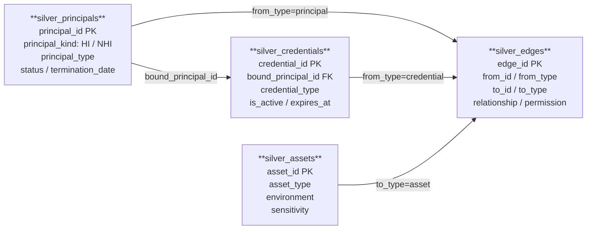

# Silver Schema Contract

## 버전

```text
version: 0.1.1
status: draft
updated_at: 2026-06-29
```

## 변경이력

| 버전 | 날짜 | 변경 내용 |
| --- | --- | --- |
| 0.1.1 | 2026-06-29 | 컬럼별 품질검증 기준과 미확정 정책 표시 추가 |
| 0.1.0 | 2026-06-24 | 최소 Silver 4테이블 계약, deterministic id, relationship 매트릭스, 처리 방식 추가 |

## 목적

Silver는 원본 데이터를 공통 모델로 정규화하는 레이어다.

Silver에는 탐지에 필요한 사실만 둔다. 위험 점수, severity, finding, 권장 조치, 화면 표시용 문구는 Silver에 두지 않는다.

## ERD



> `silver_edges`는 폴리모픽 구조다. `from_id`, `to_id`는 `from_type`, `to_type`에 따라 principals / credentials / assets 중 하나를 가리킨다. 직접 FK 제약은 없고, 탐지 쿼리에서 `from_type`, `to_type` 조건으로 방향을 특정한다.

---

## 테이블

최소 Silver 테이블은 4개다.

```text
silver_principals
silver_credentials
silver_assets
silver_edges
```

처리 방식은 다음 두 가지를 사용한다.

```text
Bronze 매핑: Bronze 원본 데이터에 있는 값을 Silver 공통 모델에 맞춰 옮긴 것
Silver 파생: Silver 정규화 과정에서 id 생성, 타입 분류, 상태 계산, 관계 연결을 위해 만든 것
```

## ID 생성 규칙

Silver의 내부 id는 deterministic해야 한다. 같은 source record는 재실행해도 같은 id를 가져야 한다.

`source_*` 컬럼은 외부 source나 seed에 존재하는 원본 id를 보존한다. `principal_id`, `credential_id`, `asset_id`, `edge_id`는 Silver 내부에서 조인과 추적을 위해 만든 stable id다. 탐지나 eval 비교에서 source id와 내부 id를 혼용하지 않는다.

`source_system` 값은 아래 값을 사용한다.

| 값 | 의미 |
| --- | --- |
| `entra_id` | Microsoft Entra ID source shape |
| `identity_seed` | HR/IdP lifecycle 합성 입력 |
| `assets_seed` | asset inventory 합성 입력 |
| `access_seed` | access edge 합성 입력 |
| `github` | GitHub App, credential, repo, access edge 합성 입력 후보 |
| `google_workspace` | Google Workspace user, shared drive/document, access edge 합성 입력 후보 |
| `slack` | Slack user, private channel, access edge 합성 입력 후보 |

`source_system`은 ID namespace와 원천 shape 구분에 사용한다. Gold나 화면에서 Azure/GitHub/SaaS 같은 source category를 표시할 때는 `source_system` 단독이 아니라 `principal_type`, `asset_type`을 함께 해석한다.

기본 규칙:

```text
principal_id  = sha256(source_system + ':' + source_principal_id + ':' + principal_type)
credential_id = sha256(source_system + ':' + source_credential_id + ':' + bound_principal_id)
asset_id      = sha256(source_system + ':' + source_asset_id + ':' + asset_type)
edge_id       = sha256(source_system + ':' + from_id + ':' + normalized_relationship + ':' + to_id)
```

MVP에서는 동일 `from_id` / `relationship` / `to_id` 조합을 하나의 access edge로 본다. 같은 자산에 대해 여러 권한이 동시에 존재하더라도 `permission`은 대표 권한 또는 가장 강한 권한 하나로 정규화한다. 권한별 row 분리는 후속 확장에서 별도 `source_edge_id` 또는 `permission` 포함 key로 검토한다.

S1 access edge는 Silver에서 `relationship = 'accesses_asset'`으로 정규화한다. `edge_id`는 source 원본 relationship이 아니라 Silver 정규화 후 relationship 기준으로 생성한다.

Silver의 `*_id` primary key는 Databricks DDL 제약과 별개로 테이블 안에서 논리적으로 unique해야 한다. 동일한 ID가 둘 이상이면 source 중복 또는 변환 deduplication 문제로 분류한다. `source_*` 값은 내부 ID로 대체하지 않고 Bronze source ID를 그대로 보존한다. 별도로 명시하지 않은 나머지 컬럼에는 단일 컬럼 unique를 요구하지 않는다.

## silver_principals

권한을 가질 수 있는 주체를 담는다.

| 컬럼 | 타입 | 필수 | 처리 방식 | 설명 | Validation |
| --- | --- | --- | --- | --- | --- |
| principal_id | string | yes | Silver 파생 | 내부 stable id | null 또는 빈 문자열이면 실패. 테이블 안에서 unique하고 ID 생성 규칙으로 재계산한 값과 일치해야 한다. |
| source_system | string | yes | Bronze 매핑 | 데이터 원천 | null이면 실패. 현재 principal source인 `entra_id`, `identity_seed` 중 하나여야 한다. dev 확장 합성 데이터의 GitHub App은 `entra_id`, Google Workspace/Slack user는 `identity_seed` namespace를 재사용한다. |
| source_principal_id | string | yes | Bronze 매핑 | source의 원본 principal id | null 또는 빈 문자열이면 실패. 대응 Bronze `app_id` 또는 `user_principal_name`과 동일해야 한다. |
| principal_kind | string | yes | Silver 파생 | `HI` 또는 `NHI` | null이면 실패. 값은 `HI`, `NHI` 중 하나여야 한다. 현재 `user`, Google Workspace user, Slack user는 `HI`, Entra App Registration과 GitHub App은 `NHI`로 변환한다. |
| principal_type | string | yes | Bronze 매핑 | `user`, `group`, `service_principal`, `app_registration`, `github_app`, `service_account`, `unknown` | null이면 실패. 명시된 enum 안의 값이어야 하며 ID 재계산에 같은 값을 사용해야 한다. |
| display_name | string | no | Bronze 매핑 | 표시 이름 | 값이 있으면 대응 Bronze 표시 이름과 의미가 같아야 한다. HI는 `bronze_identity_lifecycle_seed.display_name`을 우선 사용하고, 값이 없으면 `user_principal_name`을 fallback으로 쓸 수 있다. |
| email | string | no | Bronze 매핑 | 사람 계정의 email 또는 UPN | 값이 있으면 대응 Bronze UPN/email을 보존해야 한다. 허용 포맷은 `확인 필요`. |
| status | string | yes | Bronze 매핑 | `active`, `inactive`, `terminated`, `unknown` | null이면 실패. 명시된 enum 안의 값이어야 한다. source 상태를 Silver enum으로 매핑하는 전체 규칙은 `확인 필요`. |
| termination_date | date | no | Bronze 매핑 | 퇴사일 또는 비활성 기준일 | 값이 있으면 date 타입이며 대응 Bronze 날짜와 같아야 한다. `terminated` 상태에서 필수인지 여부는 `확인 필요`. |
| observed_at | timestamp | yes | Bronze 매핑 | 이 사실을 관측한 시각. 기본값은 원천 Bronze row의 `_ingestion_ts` | null이면 실패. 대응 Bronze `_ingestion_ts`와 같은 시점을 나타내야 한다. |

예시:

```json
{
  "principal_id": "sha256(identity_seed:kim.minsu@company.com:user)",
  "source_system": "identity_seed",
  "source_principal_id": "kim.minsu@company.com",
  "principal_kind": "HI",
  "principal_type": "user",
  "display_name": "김민수",
  "email": "kim.minsu@company.com",
  "status": "terminated",
  "termination_date": "2024-01-15",
  "observed_at": "2026-06-23T00:00:00Z"
}
```

## silver_credentials

Principal을 행사할 수 있게 하는 credential metadata를 담는다.

Secret value, token value, private key value는 저장하지 않는다.

| 컬럼 | 타입 | 필수 | 처리 방식 | 설명 | Validation |
| --- | --- | --- | --- | --- | --- |
| credential_id | string | yes | Silver 파생 | 내부 stable id | null 또는 빈 문자열이면 실패. 테이블 안에서 unique하고 ID 생성 규칙으로 재계산한 값과 일치해야 한다. |
| source_system | string | yes | Bronze 매핑 | 데이터 원천 | null이면 실패. 현재 credential source는 `entra_id`여야 한다. dev 확장 합성 데이터의 GitHub credential도 `entra_id` namespace를 재사용한다. |
| source_credential_id | string | yes | Bronze 매핑 | source의 원본 credential id | null 또는 빈 문자열이면 실패. 대응 Bronze `key_id`와 동일해야 한다. |
| bound_principal_id | string | yes | Silver 파생 | credential이 연결된 principal id | null이면 실패. `silver_principals.principal_id`에 존재하고 대응 Bronze `app_id`로 재계산한 principal ID와 같아야 한다. |
| credential_type | string | yes | Bronze 매핑 | `client_secret`, `certificate`, `pat`, `deploy_key`, `api_key`, `unknown` | null이면 실패. 명시된 enum 안의 값이어야 한다. Entra password credential은 `client_secret`, GitHub credential은 source 값에 따라 `deploy_key` 또는 `pat`로 변환된다. |
| display_name | string | no | Bronze 매핑 | 표시 이름 | 값이 있으면 대응 Bronze `display_name`과 의미가 같아야 한다. |
| status | string | yes | Bronze 매핑 | `active`, `expired`, `revoked`, `unknown` | null이면 실패. 명시된 enum 안의 값이어야 한다. source 상태 매핑의 전체 규칙은 `확인 필요`. |
| expires_at | timestamp | no | Bronze 매핑 | 만료 시각 | 값이 있으면 대응 Bronze `end_date_time`과 같은 시점을 나타내야 한다. |
| is_active | boolean | yes | Silver 파생 | 현재 유효한 credential인지 여부 | null이면 실패. `status == 'active' AND (expires_at IS NULL OR expires_at > observed_at)` 계산 결과와 같아야 한다. |
| observed_at | timestamp | yes | Bronze 매핑 | 이 사실을 관측한 시각. 기본값은 원천 Bronze row의 `_ingestion_ts` | null이면 실패. 대응 Bronze `_ingestion_ts`와 같은 시점을 나타내야 하며 `is_active`의 기준일로 사용한다. |

예시:

```json
{
  "credential_id": "sha256(entra_id:key-001:<payment-service-prod principal_id>)",
  "source_system": "entra_id",
  "source_credential_id": "key-001",
  "bound_principal_id": "<payment-service-prod principal_id>",
  "credential_type": "client_secret",
  "display_name": "prod-secret",
  "status": "active",
  "expires_at": "2027-12-31T00:00:00Z",
  "is_active": true,
  "observed_at": "2026-06-23T00:00:00Z"
}
```

`is_active` 파생 규칙:

```text
is_active = status == 'active' AND (expires_at IS NULL OR expires_at > observed_at)
```

`expires_at`이 없는 credential은 source에서 만료 개념을 제공하지 않는 경우로 보고, `status`가 `active`이면 active로 판단한다.

## silver_assets

접근 대상이 되는 자산을 담는다.

| 컬럼 | 타입 | 필수 | 처리 방식 | 설명 | Validation |
| --- | --- | --- | --- | --- | --- |
| asset_id | string | yes | Silver 파생 | 내부 stable id | null 또는 빈 문자열이면 실패. 테이블 안에서 unique하고 ID 생성 규칙으로 재계산한 값과 일치해야 한다. |
| source_system | string | yes | Bronze 매핑 | 데이터 원천 | null이면 실패. 현재 asset source는 `assets_seed`여야 한다. dev 확장 합성 데이터의 GitHub repo, Google Workspace asset, Slack channel도 `assets_seed` namespace를 재사용한다. |
| source_asset_id | string | yes | Bronze 매핑 | source의 원본 asset id | null 또는 빈 문자열이면 실패. 대응 Bronze `asset_id`와 동일해야 한다. |
| asset_type | string | yes | Bronze 매핑 | `cloud_resource`, `repo`, `database`, `workspace`, `saas_app`, `unknown` | null이면 실패. 명시된 enum 안의 값이어야 한다. asset seed는 `cloud_resource`, GitHub repo는 `repo`, Google Workspace asset은 `workspace`, Slack channel은 `saas_app`으로 변환된다. |
| display_name | string | no | Bronze 매핑 | 표시 이름 | 값이 있으면 대응 Bronze `name`과 의미가 같아야 한다. |
| environment | string | yes | Bronze 매핑 | `production`, `staging`, `development`, `unknown` | null이면 실패. 명시된 enum 안의 값이어야 한다. source 값 매핑의 전체 규칙은 `확인 필요`. |
| sensitivity | string | yes | Bronze 매핑 | `critical`, `high`, `medium`, `low`, `unknown` | null이면 실패. 명시된 enum 안의 값이어야 하며 Bronze source 값을 임의로 낮추지 않는다. |
| observed_at | timestamp | yes | Bronze 매핑 | 이 사실을 관측한 시각. 기본값은 원천 Bronze row의 `_ingestion_ts` | null이면 실패. 대응 Bronze `_ingestion_ts`와 같은 시점을 나타내야 한다. |

예시:

```json
{
  "asset_id": "sha256(assets_seed:payment-api:cloud_resource)",
  "source_system": "assets_seed",
  "source_asset_id": "payment-api",
  "asset_type": "cloud_resource",
  "display_name": "payment-api",
  "environment": "production",
  "sensitivity": "high",
  "observed_at": "2026-06-23T00:00:00Z"
}
```

## silver_edges

Principal, credential, asset 사이의 관계를 담는다.

| 컬럼 | 타입 | 필수 | 처리 방식 | 설명 | Validation |
| --- | --- | --- | --- | --- | --- |
| edge_id | string | yes | Silver 파생 | 내부 stable id | null 또는 빈 문자열이면 실패. 테이블 안에서 unique하고 정규화된 relationship 기준 ID 생성 규칙으로 재계산한 값과 일치해야 한다. |
| source_system | string | yes | Bronze 매핑 | 데이터 원천 | null이면 실패. 현재 owner edge는 `entra_id`, access edge와 dev 확장 합성 데이터의 GitHub/Google Workspace/Slack access edge는 `access_seed`를 사용한다. |
| from_id | string | yes | Silver 파생 | 출발 노드 id | null이면 실패. `from_type`이 가리키는 Silver 테이블에 존재해야 한다. |
| from_type | string | yes | Silver 파생 | `principal`, `credential`, `asset` | null이면 실패. 명시된 enum 안의 값이고 `relationship` 방향 규칙과 일치해야 한다. |
| to_id | string | yes | Silver 파생 | 도착 노드 id | null이면 실패. `to_type`이 가리키는 Silver 테이블에 존재해야 한다. |
| to_type | string | yes | Silver 파생 | `principal`, `credential`, `asset` | null이면 실패. 명시된 enum 안의 값이고 `relationship` 방향 규칙과 일치해야 한다. |
| relationship | string | yes | Silver 파생 | `owns_principal`, `owns_credential`, `manages_principal`, `manages_credential`, `accesses_credential`, `manages_asset`, `accesses_asset`, `unknown` | null이면 실패. 명시된 enum 안의 값이며 아래 관계유형 규칙의 `from_type -> to_type` 조합을 만족해야 한다. |
| permission | string | no | Bronze 매핑 | role 또는 permission 이름 | 값이 있으면 대응 Bronze permission을 정규화한 결과여야 한다. 동일 edge의 대표 권한 선택 규칙은 `확인 필요`. |
| status | string | yes | Bronze 매핑 | `active`, `inactive`, `unknown` | null이면 실패. 명시된 enum 안의 값이어야 한다. owner edge의 현재 고정값은 `active`다. |
| evidence_source | string | no | Silver 파생 | 관계를 확인한 source 또는 방법 | 값이 있으면 관계를 만든 Bronze source 또는 테이블을 식별할 수 있어야 한다. 허용값 목록은 `확인 필요`. |
| observed_at | timestamp | yes | Bronze 매핑 | 이 관계를 관측한 시각. 기본값은 원천 Bronze row의 `_ingestion_ts` | null이면 실패. 관계의 근거가 된 Bronze row의 `_ingestion_ts`와 같은 시점을 나타내야 한다. |

예시:

```json
{
  "edge_id": "sha256(access_seed:<payment-service-prod principal_id>:accesses_asset:<payment-api asset_id>)",
  "source_system": "access_seed",
  "from_id": "<payment-service-prod principal_id>",
  "from_type": "principal",
  "to_id": "<payment-api asset_id>",
  "to_type": "asset",
  "relationship": "accesses_asset",
  "permission": "invoke",
  "status": "active",
  "evidence_source": "bronze_access_edges_seed",
  "observed_at": "2026-06-23T00:00:00Z"
}
```

### 관계유형 규칙

`silver_edges`는 단일 테이블로 여러 관계를 표현한다. 따라서 `relationship`은 필수이며, 각 관계는 허용되는 `from_type -> to_type` 방향을 지켜야 한다.

관계 이름은 `<행위>_<대상>` 형식을 따른다.

| 방향 | 소유 | 관리 | 접근 |
| --- | --- | --- | --- |
| `principal -> principal` | `owns_principal` | `manages_principal` |  |
| `principal -> credential` | `owns_credential` | `manages_credential` | `accesses_credential` |
| `principal -> asset` |  | `manages_asset` | `accesses_asset` |
| `credential -> asset` |  |  | `accesses_asset` |

`owns_credential`은 credential이 해당 principal에 귀속되어 있음을 의미한다. 실제 secret 값을 알고 있다는 뜻은 아니다.

`credential -> asset` 형태의 `accesses_asset`은 PAT, deploy key, API key처럼 credential 자체가 접근 단위로 쓰이는 source에서 사용한다. Azure App Registration client secret처럼 principal을 행사하기 위한 credential은 기본적으로 `principal -> asset` 관계로 표현한다.

역방향 관계는 별도로 만들지 않는다. 예를 들어 `credential`이 어떤 principal에 귀속되는지는 `principal -> credential` 방향의 `owns_credential`로 표현한다. `asset`이 어떤 principal에게 접근을 허용하는지도 `principal -> asset` 또는 `credential -> asset` 방향의 `accesses_asset`으로 표현한다.

탐지 쿼리에서는 `relationship`만 보지 말고 `from_type`, `to_type`도 함께 조건으로 사용한다.

예:

```sql
relationship = 'owns_credential'
AND from_type = 'principal'
AND to_type = 'credential'
```

경로 예시 1. 퇴사자가 credential을 관리할 수 있고, 그 credential이 asset 접근으로 이어지는 경우:

```text
terminated HI principal
  --manages_credential-->
credential
  --accesses_asset-->
asset
```

경로 예시 2. Postman 계정이 잔존하고, 그 계정이 live credential에 접근 가능하며, credential이 asset 접근으로 이어지는 경우:

```text
stale Postman principal
  --accesses_credential-->
live credential
  --accesses_asset-->
asset
```

## Silver에 두지 않는 것

아래 항목은 Silver에 저장하지 않는다.

```text
risk_score
severity
finding_id
recommended_action
why_risky
evidence_path_text
dashboard label
is_planted_risk
is_distractor
expected_severity
seed_finding_type
truth_class
secret value
token value
private key value
```

검증 시 Silver 스키마와 저장 row에 위 정답 라벨 및 secret, token, private key의 실제 값이 포함되지 않았는지 확인한다. 필드명 탐지 범위와 마스킹 판정 방식은 `확인 필요`다.

## Finding type 계산 가능성

Silver는 `finding_type`을 저장하지 않는다. 다만 다음 레이어가 finding type을 계산할 수 있도록 필요한 원자 사실을 보존한다.

| 다음 레이어 finding_type 후보 | Silver 기반 조건 |
| --- | --- |
| `NHI Access Drift` | `principal_kind = 'NHI'` + active `accesses_asset` edge + sensitive asset |
| `NHI Credential Drift` | `principal_kind = 'NHI'` + active credential + owner/status 문제 |
| `NHI Permission Drift` | `principal_kind = 'NHI'` + active permission/role edge |
| `HI Access Drift` | `principal_kind = 'HI'` + active `accesses_asset` edge + sensitive asset |
| `HI Permission Drift` | `principal_kind = 'HI'` + active permission/role |
| `HI Stale Access` | `principal_kind = 'HI'` + `status in ('terminated', 'inactive')` + remaining access/permission |

위 값은 Silver 컬럼이 아니라 Intermediate/Gold에서 계산하는 제품 분류다. 하나의 finding이 여러 조건을 동시에 만족할 수 있으므로, 대표 `finding_type` 선택과 세부 `risk_factors` 분리는 다음 레이어 계약에서 정한다.

## 다음 레이어로 넘기는 기준

Silver는 사실을 담는다.

여러 Silver 테이블을 조인해 탐지 결과를 만들면 그 결과는 Intermediate에 둔다.

예:

```text
terminated HI
  + owns_principal/manages_principal NHI
  + active credential
  + accesses_asset sensitive asset
  = Intermediate finding candidate
```
